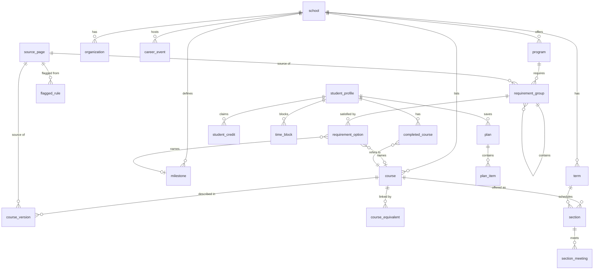

# Data model

Status: **approved with changes (founder review of PR #1)**. No SQL migrations exist yet; they're
written next, with row-level security and tests, following this document.

## The big picture in plain language

There are two kinds of data, and they are kept strictly apart:

1. **Catalog data** (public facts we collect): schools, programs, courses, prerequisites,
   requirements, milestones, terms, class sections, clubs and career events. Anyone signed in can
   read it; only you (admin) and the collectors can write it. Every row points to the **source
   page** it came from, and nothing is shown to students until you've approved it.
2. **Student data** (private): profile, completed courses, credits, weekly time blocks and saved
   plans. Each student can read and change only their own rows. Deleting an account deletes all
   of it.

Design choices worth knowing about:

- **A course has a stable identity, plus one description per catalog year.** "ME 112 at Fresno
  State" is one `course` row forever. What the catalog says about it in a given year (title,
  units, prerequisites) is a `course_version` row. Student records point at the stable identity,
  so a student's history never breaks when the catalog is updated.
- **Renumbered and cross-listed courses are linked explicitly** in `course_equivalent`, so if a
  course was renumbered, or the same class is listed under two departments, the engine counts it
  correctly. Links come from catalog text and go through the review queue like everything else.
- **Everything rule-like is stored per catalog year.** A 2023 Mechanical student and a 2026
  Mechanical student can have different requirements.
- **Prerequisites are stored as a small structured rule, not as text,** alongside the original
  catalog wording (example below). If the collector can't turn the wording into a rule with
  confidence, it goes to the review queue instead of guessing.
- **A review gate on all collected data.** Rule-bearing rows have a `review_status`:
  `pending_review` → `live` (you approved) or `rejected`. The engine and the AI only ever see
  `live` rows.
- **Some things the engine can never mark as met.** GPA minimums and credits the student reports
  are shown as "check with your advisor" / "confirm this credit appears on your record", never as
  done. We don't collect GPA, so we can't verify it.

## Diagram



## Catalog data

### Schools, sources and programs

- **`school`**: Fresno State, UC Berkeley. Fields: `slug`, `name`, `college_name`,
  `term_system` (semester).
- **`source_page`**: every page we collected from. Fields: `url`, `fetched_at`, `content_hash`,
  `raw_path` (saved copy), `robots_ok`.
- **`program`**: one major in one catalog year. Fields: `school_id`, `major_code` (e.g.
  `BS-ME`), `name`, `catalog_year` (e.g. `2025-26`), `total_units`, `source_page_id`,
  `review_status`. Unique on (school, major, catalog year).

### Courses

- **`course`**: the stable identity. Fields: `school_id`, `subject` (`ME`), `number` (`112`).
  Unique on (school, subject, number). Never deleted, only marked inactive.
- **`course_version`**: what one catalog year says about a course. Fields: `course_id`,
  `catalog_year`, `title`, `units_min`, `units_max`, `prereq_rule` (JSON), `coreq_rule` (JSON),
  `prereq_text` (original wording), `typically_offered` (fall / spring / both / unknown),
  `grading` (letter / credit-no-credit / either), `source_page_id`, `review_status`. Unique on
  (course, catalog year).
- **`course_equivalent`**: links between course identities. Fields: `course_id`,
  `equivalent_course_id`, `kind` (`renumbered`: the old number became the new one;
  `cross_listed`: the same class under two subjects), `effective_catalog_year`, `source_page_id`,
  `review_status`. The engine treats equivalent courses as one when checking prerequisites,
  requirements and "already taken".

### Requirements

- **`requirement_group`**: a block of requirements such as "Major core", "Technical electives:
  9 units" or "GE Area B". Groups can nest. Fields: `program_id`, `parent_group_id`, `level`
  (university / college / major), `name`, `rule` (`all_of`, `choose_courses` n, `choose_units`
  n), `min_grade_band`, `overlap_rule` (see below), `advisory_checks` (see below), `notes`,
  `source_page_id`, `review_status`.
- **`requirement_option`**: one way to satisfy a group. Three types (`option_type`):
  - `course`: a specific course (`course_id`).
  - `course_pattern`: e.g. "any ME course numbered 100–199" (`subject`, `number_min`,
    `number_max`, `exclusions`).
  - `milestone`: a non-course requirement (`milestone_id`).
- **`milestone`**: requirements met by an exam, a test score or a course from a list, such as
  Fresno State's Upper-Division Writing requirement, Berkeley's American History & Institutions,
  or UC Entry Level Writing. Fields: `school_id`, `code` (e.g. `FS-UDWS`, `UC-AHI`, `UC-ELWR`),
  `name`, `how_to_satisfy` (plain-language summary), `satisfying_course_ids` (if any courses
  count), `can_be_met_by_exam`, `source_page_id`, `review_status`. When a student says they met a
  milestone by exam or prior credit, the engine marks it "confirm this appears on your record",
  not done.

**Overlap rule (`overlap_rule`)**: whether a course can count toward this group and another at
the same time ("double counting"). Stored as JSON:

```json
{
  "default": "exclusive",
  "may_share_with": ["<group id>", "<group id>"],
  "max_shared_units": 6
}
```

`default` is `exclusive` (a course used here can't be used elsewhere, except for groups listed in
`may_share_with`) or `shared` (can count anywhere). If the catalog doesn't say clearly, the
collector flags it for review rather than picking one.

**Advisory checks (`advisory_checks`)**: rules the engine can't verify, mainly GPA minimums
("2.0 GPA in major courses"). Stored as `[{ "kind": "gpa", "value": 2.0, "scope": "major" }]`
and always shown as **"check with your advisor"**, never as met.

### Terms, sections, clubs and events

- **`term`**: Fall 2026, Spring 2027… Fields: `school_id`, `code` (`2027SP`), `name`,
  `starts_on`, `ends_on`, `registration_opens_on`, `add_deadline`, `drop_deadline`,
  `source_page_id`.
- **`section`**: one class section in one term. Fields: `term_id`, `course_id`, `section_code`,
  `class_number`, `component` (lecture / lab / discussion), `linked_section_group` (a lecture that
  must be taken with one of these labs), `units`, `mode` (in person / online / hybrid), `status`,
  `last_seen_at`, `source_page_id`.
- **`section_meeting`**: when and where a section meets. Fields: `section_id`, `days` (e.g.
  `{Mon,Wed}`), `start_time`, `end_time`, `location`, `starts_on`, `ends_on`.
- **`organization`**: clubs. Fields: `school_id`, `name`, `kind` (professional / social / both),
  `tags` (e.g. `structural`, `robotics`, `cultural`), `majors`, `description`, `meeting_info`,
  `url`, `source_page_id`, `review_status`.
- **`career_event`**: career fairs and employer sessions, entered by you in the admin form.
  Fields: `school_id`, `term_id`, `title`, `kind` (fair / info session / workshop), `starts_at`,
  `ends_at`, `location`, `majors`, `goal_tags`, `url`, `created_by`.
- **`flagged_rule`**: the data review queue. Fields: `entity_type` + `entity_id`,
  `source_page_id`, `source_excerpt` (the exact wording), `proposed_value` (JSON), `reason`,
  `status` (open / approved / corrected), `resolved_by`, `resolved_at`.

### Example: a prerequisite rule

Catalog text: _"Prerequisites: MATH 76 and PHYS 4A (or PHYS 4AL); minimum grade C. ME 26 may be
taken concurrently."_

```json
{
  "all": [
    { "course": "MATH 76", "min_grade_band": "c_or_better" },
    {
      "any": [{ "course": "PHYS 4A" }, { "course": "PHYS 4AL" }],
      "min_grade_band": "c_or_better"
    },
    { "course": "ME 26", "concurrent_ok": true }
  ]
}
```

Things like "or permission of instructor" or "junior standing" are stored as explicit
`{ "permission": "instructor" }` / `{ "standing": "junior" }` nodes, so the engine can tell the
student "this needs instructor permission, ask the department" rather than silently passing or
failing it.

## Student data (private)

- **`student_profile`**: one row per student. Fields: `user_id` (Supabase auth), `school_id`,
  `program_id` (which fixes the catalog year), `start_term`, `units_per_term_min` / `max`,
  `graduation_target_term`, `career_goal`, `interests`, `preferred_times`.
- **`completed_course`**: courses done, in progress or credited. Fields: `user_id`, `course_id`
  (the stable identity; a course we don't have yet is saved as free text and flagged for review),
  `grade_band`, `term_code`, `source` (`manual` / `report` / `credit`).
- **`student_credit`**: "I have credit for this requirement" (e.g. AP credit that covers a GE
  area rather than a specific course). Fields: `user_id`, `requirement_group_id` _or_
  `milestone_id`, `note` (e.g. "AP Calculus BC"), `source` (`credit`).
- **`time_block`**: work shifts, commute, other fixed time. Fields: `user_id`, `term_id`
  (optional; empty means "every term until I change it"), `day`, `start_time`, `end_time`,
  `kind` (work / commute / other). The scheduler uses the blocks for the term being planned, and
  falls back to the blocks with no term.
- **`plan`**: a saved long-term plan or next-term schedule. Fields: `user_id`, `kind`
  (long_term / term), `term_id`, `engine_version`, `catalog_snapshot` (which data it was built
  from), `check_passed`, `relies_on_credit`, `created_at`.
- **`plan_item`**: one course or section in a plan. Fields: `plan_id`, `term_code`, `course_id`,
  `section_id`, `reason`.
- **`ai_usage`**: daily counter used to cap AI spend per student. Fields: `user_id`, `day`,
  `requests`, `tokens`, `cost_cents`.
- **`answer_feedback`**: thumbs up or down on an AI answer. Fields: `rating` (up / down),
  `school_id`, `created_at`. No chat text and no user link.

### Grade bands

We store a grade band, not letter grades. A plain yes/no can't tell a pass/no-pass course or a C-
apart from a failed course, and some requirements treat those differently.

| `grade_band`     | Meaning                                          |
| ---------------- | ------------------------------------------------ |
| `c_or_better`    | Letter grade of C or higher                      |
| `passed_below_c` | Passed with C- or D (counts for some rules)      |
| `pass_no_pass`   | Taken pass/no-pass (credit/no-credit) and passed |
| `in_progress`    | Enrolled this term, no grade yet                 |

Failed and withdrawn courses aren't entered; they don't satisfy anything.

### Credit

- "I have credit for this course" is a `completed_course` row with `source = credit`.
- "I have credit for this requirement" is a `student_credit` row with `source = credit`.
- The engine counts both, but any plan that relies on credit is marked `relies_on_credit` and
  shows **"Confirm this credit appears on your record"** next to each affected item.

## Privacy and security

- **What we don't store:** names (the email lives only in Supabase's auth system), school
  passwords, student IDs, GPA, letter grades, chat conversations, and the uploaded
  degree-progress PDF. Club and event picks aren't stored; they're recomputed from the profile.
- **Uploaded progress report:** read in memory, never written to storage. The student's name,
  student ID and GPA are stripped from the extracted text before any of it reaches the AI. The
  student confirms the courses we found, we save only the confirmed course list, and the file is
  discarded. The privacy page will say this in plain language.
- **Chat:** kept only for the current visit, meaning until the tab closes or 24 hours pass,
  whichever comes first. It lives in the browser session, not in the database. Saved plans hold
  what matters.
- **Row-level security on every table.** Student tables: a row is visible only when
  `user_id = auth.uid()`. Catalog tables: read-only for signed-in users, and only `live` rows.
  Admin writes are checked against an `app_admin` table that only you are in. `answer_feedback`
  is insert-only for students and readable only by admin.
- **Deletion:** every student table references the auth user with `on delete cascade`, so
  "Delete my account" removes everything in one step. A test will prove it.
- **Encryption at rest:** Supabase encrypts the whole database and file storage on disk. The
  free-text fields (`career_goal`, `interests`, credit `note`) are short and contain no
  identifiers, so no extra column encryption for version 1.

## For the privacy page (Phase 3)

These commitments must appear on the privacy page in plain language:

1. Your uploaded progress report is read once to find your courses, then deleted. We never store
   the file.
2. Your name, student ID and GPA are removed before any text is sent to the AI.
3. Chat conversations aren't saved; they disappear when you close the tab or after 24 hours.
4. We never ask for your school password.
5. "Delete my account" permanently removes everything we have about you.
