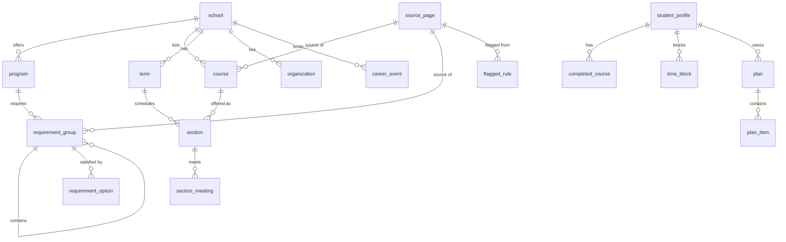

# Data model (proposal for review)

Status: **proposal**. No SQL migrations exist yet. Once you approve this (or tell me what to
change), I'll write it as Supabase migrations with row-level security and tests.

## The big picture in plain language

There are two kinds of data, and they are kept strictly apart:

1. **Catalog data** (public facts we collect): schools, programs, courses, prerequisites,
   requirements, terms, class sections, clubs and career events. Anyone signed in can read it;
   only you (admin) and the collectors can write it. Every row points to the **source page** it
   came from, and nothing is shown to students until you've approved it.
2. **Student data** (private): profile, completed courses, weekly time blocks and saved plans.
   Each student can read and change only their own rows. Deleting an account deletes all of it.

Three design choices worth knowing about:

- **Everything rule-like is stored per catalog year.** A 2023 Mechanical student and a 2026
  Mechanical student can have different requirements, so `program`, `course` and requirement
  groups all carry a catalog year.
- **Prerequisites are stored as a small structured rule, not as text.** The catalog says things
  like "MATH 76 and either PHYS 4A or PHYS 4AL, with a C or better". We store that as a tree the
  engine can check exactly (example below), alongside the original catalog wording for
  traceability. If the collector can't turn the wording into a rule with confidence, it goes to
  the review queue instead of guessing.
- **A review gate on all collected data.** Rule-bearing rows have a `review_status`:
  `pending_review` → `live` (you approved) or `rejected`. The engine and the AI only ever see
  `live` rows.

## Diagram



## Catalog data

| Table                | What it holds                                                                                                  | Key fields                                                                                                                                                                                                                                                         |
| -------------------- | -------------------------------------------------------------------------------------------------------------- | ------------------------------------------------------------------------------------------------------------------------------------------------------------------------------------------------------------------------------------------------------------------ |
| `school`             | Fresno State, UC Berkeley                                                                                      | `slug`, `name`, `college_name`, `term_system` (semester)                                                                                                                                                                                                           |
| `source_page`        | Every page we collected from                                                                                   | `url`, `fetched_at`, `content_hash`, `raw_path` (saved copy), `robots_ok`                                                                                                                                                                                          |
| `program`            | One major in one catalog year                                                                                  | `school_id`, `major_code` (e.g. `BS-ME`), `name`, `catalog_year` (e.g. `2025-26`), `total_units`, `source_page_id`, `review_status`. Unique on (school, major, catalog year)                                                                                       |
| `course`             | One course as described in one catalog year                                                                    | `school_id`, `catalog_year`, `subject` (`ME`), `number` (`112`), `title`, `units_min`, `units_max`, `prereq_rule` (JSON), `coreq_rule` (JSON), `prereq_text` (original wording), `typically_offered` (fall/spring/both/unknown), `source_page_id`, `review_status` |
| `requirement_group`  | A block of requirements: "Major core", "Technical electives: 9 units", "GE Area B". Groups can nest.           | `program_id`, `parent_group_id`, `level` (university / college / major), `name`, `rule` (`all_of`, `choose_courses` n, `choose_units` n), `min_grade`, `notes`, `source_page_id`, `review_status`                                                                  |
| `requirement_option` | What can satisfy a group: a specific course, or a pattern like "any ME upper-division course numbered 100–199" | `group_id`, `course_subject`, `course_number` _or_ `subject` + `number_min`/`number_max`, `exclusions`                                                                                                                                                             |
| `term`               | Fall 2026, Spring 2027…                                                                                        | `school_id`, `code` (`2027SP`), `name`, `starts_on`, `ends_on`, `registration_opens_on`, `add_deadline`, `drop_deadline`, `source_page_id`                                                                                                                         |
| `section`            | One class section in one term                                                                                  | `term_id`, `course_id`, `section_code`, `class_number`, `component` (lecture/lab/discussion), `linked_section_group` (lecture must be taken with one of these labs), `units`, `mode` (in person/online/hybrid), `status`, `last_seen_at`, `source_page_id`         |
| `section_meeting`    | When and where a section meets                                                                                 | `section_id`, `days` (e.g. `{Mon,Wed}`), `start_time`, `end_time`, `location`, `starts_on`/`ends_on`                                                                                                                                                               |
| `organization`       | Clubs                                                                                                          | `school_id`, `name`, `kind` (professional/social/both), `tags` (e.g. `structural`, `robotics`, `cultural`), `majors`, `description`, `meeting_info`, `url`, `source_page_id`, `review_status`                                                                      |
| `career_event`       | Career fairs and employer sessions, entered by you in the admin form                                           | `school_id`, `term_id`, `title`, `kind` (fair/info session/workshop), `starts_at`, `ends_at`, `location`, `majors`, `goal_tags`, `url`, `created_by`                                                                                                               |
| `flagged_rule`       | The data review queue                                                                                          | `entity_type` + `entity_id`, `source_page_id`, `source_excerpt` (the exact wording), `proposed_value` (JSON), `reason`, `status` (open/approved/corrected), `resolved_by`, `resolved_at`                                                                           |

### Example: a prerequisite rule

Catalog text: _"Prerequisites: MATH 76 and PHYS 4A (or PHYS 4AL); minimum grade C. ME 26 may be
taken concurrently."_

```json
{
  "all": [
    { "course": "MATH 76", "min_grade": "C" },
    {
      "any": [{ "course": "PHYS 4A" }, { "course": "PHYS 4AL" }],
      "min_grade": "C"
    },
    { "course": "ME 26", "concurrent_ok": true }
  ]
}
```

Things like "or permission of instructor" or "junior standing" are stored as explicit
`{ "permission": "instructor" }` / `{ "standing": "junior" }` nodes, so the engine can tell the
student "this needs instructor permission, ask the department" rather than silently passing or
failing it.

## Student data (private)

| Table              | What it holds                                  | Key fields                                                                                                                                                                                             |
| ------------------ | ---------------------------------------------- | ------------------------------------------------------------------------------------------------------------------------------------------------------------------------------------------------------ |
| `student_profile`  | One row per student                            | `user_id` (Supabase auth), `school_id`, `program_id` (which fixes the catalog year), `start_term`, `units_per_term_min`/`max`, `graduation_target_term`, `career_goal`, `interests`, `preferred_times` |
| `completed_course` | Courses done or in progress                    | `user_id`, `course_id` (or free text when not in our list, flagged), `status` (completed/in progress), `grade_band` (see question 2), `term_code`, `source` (manual/report)                            |
| `time_block`       | Work shifts, commute, other fixed time         | `user_id`, `day`, `start_time`, `end_time`, `kind` (work/commute/other)                                                                                                                                |
| `plan`             | A saved long-term plan or next-term schedule   | `user_id`, `kind` (long_term/term), `term_id`, `engine_version`, `catalog_snapshot` (which data it was built from), `check_passed`, `created_at`                                                       |
| `plan_item`        | One course or section in a plan                | `plan_id`, `term_code`, `course_id`, `section_id`, `reason`                                                                                                                                            |
| `ai_usage`         | Daily counter used to cap AI spend per student | `user_id`, `day`, `requests`, `tokens`, `cost_cents`                                                                                                                                                   |

What we deliberately **don't** store: names (the email lives only in Supabase's auth system),
school passwords or student IDs, and the uploaded degree-progress PDF (see question 1). Club and
event picks aren't stored; they're recomputed from the profile.

### Privacy and security in the database

- **Row-level security on every table.** Student tables: a row is visible only when
  `user_id = auth.uid()`. Catalog tables: read-only for signed-in users, and only `live` rows.
  Admin writes are checked against an `app_admin` table that only you are in.
- **Deletion:** every student table references the auth user with `on delete cascade`, so
  "Delete my account" removes everything in one step. A test will prove it.
- **Encryption at rest:** Supabase encrypts the whole database and file storage on disk. The
  free-text fields (`career_goal`, `interests`) are short and contain no identifiers; I don't
  think extra column encryption is worth the complexity, but say so if you'd like it.

## Questions for you

1. **Uploaded progress report:** I recommend we parse the PDF in memory, show the student the
   courses we found to confirm, then **throw the file away** and keep only the confirmed course
   list. Less to protect, simpler deletion. OK?
2. **Grades:** some prerequisites need "C or better". Options: (a) ask only "passed with C or
   better? yes/no" per course (my recommendation: minimal and enough for the rules), or
   (b) store the actual letter grade.
3. **Chat history:** keep it (so students can scroll back across visits) or keep it only for the
   current session? I recommend session-only for version 1.
4. **Transfer and AP credit:** common for engineering students. For version 1 I suggest a simple
   "I have credit for this course" checkbox in the course list, stored like a completed course
   with `source = credit`, rather than modelling articulation agreements. OK?
